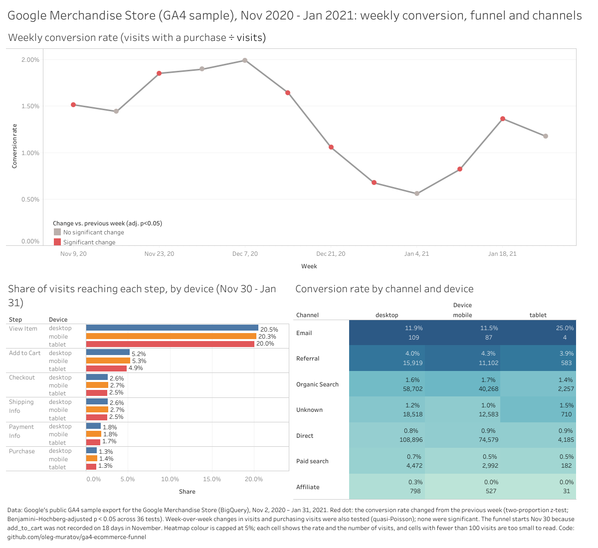

# GA4 e-commerce funnel: Google Merchandise Store

Funnel, channel and week-over-week analysis of Google's public Google Analytics 4 (GA4) export for the
Google Merchandise Store (November 1, 2020 – January 31, 2021). Visits are rebuilt from raw events in BigQuery
SQL, the export is audited for what it can be trusted for, week-over-week changes are tested in Python, and the
results are published as a Tableau Public dashboard.

**Dashboard:** [Google Merchandise Store on Tableau Public](https://public.tableau.com/views/GA4E-commerceFunnel_17919914049840/Dashboard)

[](https://public.tableau.com/views/GA4E-commerceFunnel_17919914049840/Dashboard)

## Results

Weekly figures use full weeks, from Monday, November 2 to Sunday, January 31; a visit counts in the week it
starts. The data are a scrambled sample (see "What the data can and cannot show" below), so the results
describe the sample, not the store's business.

### Conversion rose into December, fell after mid-December and recovered in January

Weekly conversion (visits with a purchase ÷ visits) rose from 1.0% in the week of November 2 to 2.0% in the
week of December 7, fell to 0.56% in the week of January 4, and recovered to 1.2–1.4% in the second half of
January. Seven of the twelve week-over-week changes are larger than chance, given the number of visits
(two-proportion z-test; p < 0.05 after a Benjamini–Hochberg adjustment across all 36 weekly tests): rises in
the weeks of November 9, November 23, January 11 and January 18, and falls in the weeks of December 14, 21
and 28. The timing fits holiday shopping and shipping cut-offs; the data cannot show the cause.

### Weekly traffic swings widely, and no single week stands out

Weekly visits ranged from 20,444 to 38,729. Counts have no denominator to test against, and they vary far more
from week to week than a Poisson model allows (dispersion 481 for visits and 26 for purchasing visits). Each
count change is therefore compared with the quarter's typical week-to-week swing (a quasi-Poisson test). None
of the 24 count changes stands out: the largest, in the week of December 21 (visits 33,411 → 22,083;
purchasing visits 549 → 233), has an adjusted p of 0.11.

The two kinds of test answer different questions. Judged by the count tests' standard, no conversion change
would stand out either: the same dispersion estimate is 13.6 for conversion, and the largest change then has
z = 1.7. The conversion movements are real, but they are typical of this quarter's week-to-week movement
rather than one-off shocks.

### The biggest drop is between viewing a product and adding it to the cart; devices look alike

From November 30 to January 31 (256,311 visits; add-to-cart is not fully recorded before then), 20.4% of
visits view a product, 5.2% add to the cart, 2.6% begin checkout and enter shipping details, 1.8% enter
payment details and 1.3% purchase. A visit counts at a step if the step's event occurs in it at least once.
For every four visits that view a product, about one adds to the cart; after that, about half of the cart
visits reach checkout, and about half of the checkout visits purchase. Checkout and shipping are reached by
the same visits (6,761 and 6,762), so the sample effectively records them as one step. The desktop, mobile
and tablet funnels are almost identical (purchase: 1.28%, 1.35% and 1.27%). Mobile usually converts below
desktop, so this may reflect how the sample was built rather than how shoppers behave.

### Referral converts best among the large channels; Direct is large and converts poorly

A visit's channel is the medium of its first recorded source other than the store itself. November 2 –
January 31, 357,504 visits, overall conversion 1.35%:

| Channel | Visits | Share of visits | Conversion | Share of purchasing visits |
|---|---:|---:|---:|---:|
| Organic Search | 101,227 | 28.3% | 1.65% | 34.5% |
| Direct | 187,660 | 52.5% | 0.86% | 33.4% |
| Referral | 27,604 | 7.7% | 4.11% | 23.5% |
| Unknown | 31,811 | 8.9% | 1.08% | 7.1% |
| Paid search | 7,646 | 2.1% | 0.64% | 1.0% |
| Email | 200 | 0.1% | 12.0% | 0.5% |
| Affiliate | 1,356 | 0.4% | 0.15% | < 0.1% |

Referral visits convert at about 4% on every device: 2.5 times the rate of organic search and almost 5 times
that of Direct. They are 7.7% of visits but 23.5% of purchasing visits. Direct is overstated, because visits
whose only recorded source is the store itself count as Direct (point 3 below). Email converts at 12%, but on
only 200 visits (24 with a purchase). Unknown is any other medium, including the sample's placeholders. Within
each large channel, desktop, mobile and tablet differ far less than the channels differ from each other. Which
referring sites drive the Referral result was not analysed.

## What the data can and cannot show

The data are Google's public, obfuscated sample of the store's GA4 export: 4,295,584 events over 92 days,
grouped here into 360,129 visits. Before measuring the funnel, the export was checked for what it can be
trusted for. Each point below gives the problem, its size, and what the analysis does about it.
The queries and their results are in `sql/04_quality_checks.sql` and `sql/02_sessions_checks.sql`.

1. **It is a scrambled sample, not the store's real data.** Google replaces some values with placeholders
   (`<Other>`, `(data deleted)`) and does not guarantee internal consistency. On December 1, 10% of visits
   have a traffic source that cannot be identified. Results describe this sample, not the store's business.

2. **Some funnel steps were not tracked every day.** Product views, checkout, shipping, payment and purchase
   are recorded on all 92 days. Add-to-cart is missing on 18 days (November 2–15 and 21–24) and only partly
   recorded on November 16–20; product selection is recorded only from November 23; product-list views appear
   on 33 scattered days. The funnel therefore starts at the product view, and any rate involving add-to-cart
   uses November 30 – January 31 only (63 days, from the first full week with add-to-cart recorded every day).

3. **The store is recorded as its own traffic source.** Of the 1,428,080 events that carry a traffic source,
   756,057 (52.9%) name the store's own domain, a tracking set-up problem known as self-referral. These are
   treated as missing: a visit's channel is its first recorded source that is not the store itself. Visits
   with no other source count as Direct, so Direct (51% of visits on December 1) is overstated.

4. **Visits are rebuilt from events.** GA4 session IDs repeat across visitors, so a visit is a visitor ID plus
   a session ID, and visits that cross midnight (UTC) are joined across the daily tables. Every event falls
   in exactly one visit, and no visit spans two devices or two countries. 5,272 visits (1.5%) have no
   session-start event: about 1.2% on most days, with spikes on November 24–26, December 10–11 and
   January 27–28 that mark days with tracking problems. Counting session-start events would understate visits.

5. **Purchase events overcount purchases.** Of 5,692 purchase events, 906 (15.9%) have no transaction ID, and
   320 reuse an ID already recorded. In the most-repeated IDs, every repeat comes from the same visitor: the
   same purchase was recorded two to four times. The funnel therefore counts visits with a purchase, not
   purchase events, and revenue is not analysed.

6. **Some steps are recorded several times within one visit.** On December 1, checkout was recorded about
   3.2 times per visit that reached it, and shipping details about 1.7 times. Event counts suggest a large
   drop-off between the two steps; per visit there is none (229 visits reached both). All funnel rates are
   therefore measured per visit.

## How it is built

- `sql/01_events_overview.sql`: a first look at the export (event counts, parameters, session IDs, traffic
  sources).
- `sql/02_sessions.sql`: one row per visit (360,129 visits) from the raw events, with start time, device,
  country, channel and a yes/no flag for each funnel step. `sql/02_sessions_checks.sql` reconciles it with the
  raw events.
- `sql/04_quality_checks.sql`: the audit behind "What the data can and cannot show".
- `src/bq.py`: runs a SQL file in BigQuery. It estimates the cost with a dry run first, refuses queries above a
  size limit, and caches the result as a Parquet file.
- `src/stats.py`: the week-over-week tests (quasi-Poisson count test, two-proportion test, dispersion estimate,
  Benjamini–Hochberg adjustment) and a coverage guard that refuses weeks the data do not fully cover.
  `tests/test_stats.py` checks them against hand calculations.
- `src/export.py`: writes the three CSV files in `tableau/` that the dashboard reads.
- `notebooks/02-funnel-and-flags.ipynb`: the exploration behind the tests.

## Reproduce

Requires Python 3.12 or later, the [Google Cloud CLI](https://cloud.google.com/sdk/docs/install), and a Google
Cloud project with BigQuery (the free sandbox is enough; the sessions query reads about 1.7 GB).

```bash
python3 -m venv .venv && source .venv/bin/activate
pip install -r requirements.txt
gcloud auth application-default login
echo "GOOGLE_CLOUD_PROJECT=your-project-id" > .env
python src/check_connection.py          # expect days = 92
python src/bq.py sql/02_sessions.sql    # about 1.7 GB; cached in data/cache/
python src/export.py                    # writes tableau/*.csv
pytest
```

The notebook uses paths relative to its own folder (`../src`, `../data`), so run it with `notebooks/` as the
working directory, which Jupyter and VS Code use by default.

## Data

Google Analytics 4 sample e-commerce dataset for the Google Merchandise Store,
`bigquery-public-data.ga4_obfuscated_sample_ecommerce`, published by Google through BigQuery public datasets
([description](https://developers.google.com/analytics/bigquery/web-ecommerce-demo-dataset)). It is an
obfuscated sample, not the store's actual data.
